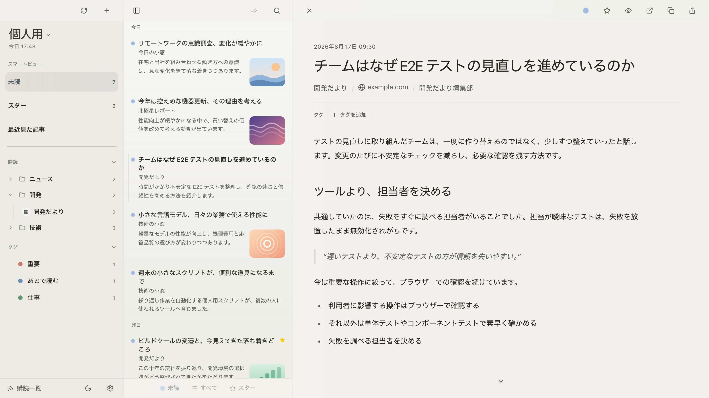
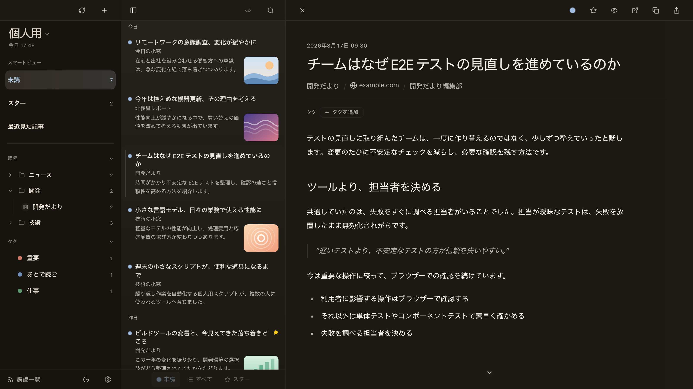

# Ultra RSS Reader

**フィードは、あなたの手元に。** オフライン全文検索と FreshRSS 同期を備えた、キーボード操作中心のデスクトップ RSS リーダー。アカウント不要・クラウド不要・サブスク不要。

 — 有料アプリ

[**ultra-rss.jey3dayo.net**](https://ultra-rss.jey3dayo.net/ja/) • [ダウンロード](#インストール) • [機能](#機能) • [キーボードショートカット](#キーボードショートカット) • [English](README.md)

ダークテーマ

## Ultra RSS Reader の特徴

- **ローカルファースト、アカウント不要** — 取得した記事はすべて組み込みの SQLite に保存され、FTS5 による全文検索がオフラインで動作します。
- **本格的な FreshRSS 同期** — Google Reader API 経由で FreshRSS サーバーと連携できます。既読・スターは双方向で同期され、未送信のローカル変更が古いリモート状態で上書きされないよう保護します。
- **認証情報は既定で OS のキーリングへ保存** — FreshRSS のパスワードやトークン、任意の Cloudflare Access Service Token は Keychain / 資格情報マネージャー / Secret Service に保存し、データベースには書き込みません。設定からローカルファイル保存に切り替えることもできます（アプリのデータフォルダへ暗号化せずに保存されます）。
- **キーボード中心の操作** — `j` / `k` での移動、単キーでの既読・スター操作、任意のフィードへ直接ジャンプできる `⌘K` コマンドパレットを搭載。キー割り当てはすべてカスタマイズできます。
- **読む流れを止めずに元ページを閲覧** — Webプレビューで配信元ページをアプリ内にそのまま開け、専用のブラウザ操作で快適に閲覧できます。

## 他のリーダーとの違い

優れた RSS リーダーは他にもたくさんあり、何を重視するかで最適な選択は変わります。

Ultra RSS Reader は、記事のアーカイブを自分の手元に残したい人、そしてキーボードから手を離さずに読み進めたい人のためのアプリです。取得した記事はすべてローカルの SQLite に蓄積され、オフラインのまま全文検索できます。同期は任意で、自分の FreshRSS サーバーに接続しても、アカウントなしでローカル専用として使っても構いません。ソースコードは MIT ライセンスで公開しています（Microsoft Store 版は有料です）。

Apple 環境で完成度の高いネイティブリーダーを求めるなら [NetNewsWire](https://netnewswire.com/) や [Reeder](https://reederapp.com/) が優れています。モバイルアプリや記事のおすすめ機能を備えたクラウド型サービスを使いたいなら [Feedly](https://feedly.com/) や [Inoreader](https://www.inoreader.com/) が向いています。Ultra RSS Reader には、クラウド型サービスに相当する機能をあえて持たせていません。

## インストール

最新のインストーラーは [**GitHub Releases**](https://github.com/jey3dayo/ultra-rss-reader/releases/latest) からダウンロードできます。

| プラットフォーム | ファイル形式 |
| --- | --- |
| macOS (Apple Silicon) | `.dmg` |
| Windows | `.exe` |

> **macOS でのご注意**: 現在のリリースは ad-hoc 署名（Apple Developer ID なし）のため、初回起動時に Gatekeeper の警告が表示されます。アプリを右クリックして「開く」を選ぶか、`xattr -dr com.apple.quarantine "/Applications/Ultra RSS Reader.app"` を実行してください。
> **Windows でのご注意**: 新規インストールには `.exe`（NSIS）インストーラー、または [Microsoft Store](https://apps.microsoft.com/detail/9N85DQ7XKQ20) をご利用ください。`.msi` は、既存の MSI 版ユーザーがアプリ内アップデータから更新を受け取れるようにするためだけに Releases へ残しています。

ソースからのビルド手順は [CONTRIBUTING.md](CONTRIBUTING.md) を参照してください。

## 機能

- 📡 **複数プロバイダー対応** — ローカル RSS/Atom フィードと FreshRSS（Google Reader API）
- 🔍 **全文検索** — SQLite FTS5 による全記事の高速なオフライン検索
- 🔄 **同期** — バックグラウンドでの定期同期、スリープ復帰時同期、手動同期、既読・スターの双方向同期（未送信変更の保護付き）
- 🔐 **FreshRSS の Cloudflare Access 対応** — HTTPS サーバー向けに任意の Service Token 認証をサポート。アカウントの追加・編集画面から Client ID と Client Secret を設定できます
- 🗂️ **フォルダとタグ** — フォルダによるフィード整理、記事タグ、ミュートキーワード
- 🧭 **コマンドパレット** — `⌘K` / `Ctrl+K` で起動し、`@` 入力で購読フィードへすぐジャンプ
- 🌐 **Webプレビュー** — 配信元ページをアプリ内に埋め込み表示し、専用のナビゲーション操作を提供
- 🧹 **購読の見直し** — 長期間更新のないフィードや取得エラーを一覧で確認し、「見直し対象外」・購読解除を判断できる購読一覧ワークスペース
- 📥 **OPML** — 購読リストのインポート・エクスポート
- 🎨 **テーマ** — システム設定に連動するライト / ダークテーマと OKLCH ベースのカラー設計
- 🇯🇵 **自然な日本語 UI** — 機械翻訳に頼らず、細部まで丁寧に整えた日本語表記
- 🔐 **安全な既定設定** — 記事 HTML は Rust 側でサニタイズしてから描画し、認証情報は SQLite データベースに保存しません

## キーボードショートカット

キー割り当てはすべて環境設定からカスタマイズできます。既定の割り当ては次のとおりです。

| キー | 動作 | キー | 動作 |
| --- | --- | --- | --- |
| `j` / `k` | 次 / 前の記事 | `m` | 既読 / 未読を切り替え |
| `h` / `l` | 前 / 次のフィード | `s` | スターを切り替え |
| `Space` / `Shift+Space` | 本文をスクロール | `a` | すべて既読にする |
| `v` | Webプレビューを開く | `b` | 外部ブラウザで開く |
| `/` | 検索 | `f` | フィルターを切り替え |
| `⌘1` / `⌘2` / `⌘3` | 未読 / すべて / スター | `u` | サイドバーにフォーカス |
| `⌘K` | コマンドパレット | `⌘\` | サイドバーを切り替え |
| `Esc` | 閉じる / 選択解除 | `⌘,` | 環境設定を開く |
| `i` | 購読一覧を開く | | |

## 技術スタック

Tauri 2 (Rust) · React 19 · TypeScript · SQLite (rusqlite + FTS5) · Tailwind CSS v4 · Zustand + TanStack Query

アーキテクチャ、開発モード、検証コマンドの詳細は [CONTRIBUTING.md](CONTRIBUTING.md) を参照してください。

## ロードマップ

Linux 向けのパッケージ生成は、リリースワークフローの手動オプション `build_linux`（既定オフ）で `.deb` / `.AppImage` を出力できる状態です。公式の配布経路はまだ整えていないため、上記のインストール表は macOS と Windows のみ記載しています。Feedly 同期への対応は予定していません。

## コントリビュート

コントリビュートを歓迎します。開発環境のセットアップ（`mise install && pnpm install && mise run app:dev`）、アーキテクチャ、品質ゲートについては [CONTRIBUTING.md](CONTRIBUTING.md) をご覧ください。運用ドキュメントは [docs/](docs/README.md) にまとまっています。

## ライセンス

[MIT](LICENSE)
