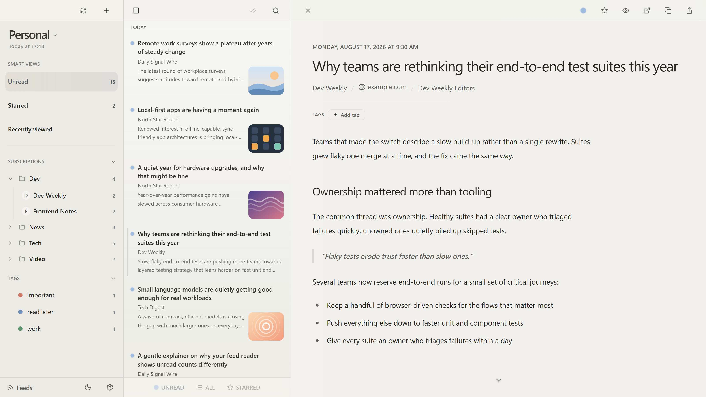

# Store Screenshot Capture Policy

## Purpose

This document fixes how the product screenshots are produced, so they can be regenerated with one command and never show a third party's brand as the focus of the screen.

It covers every committed screenshot:

- `docs/assets/screenshot-reader-<theme>-<os>.jpg`, used by the READMEs and mirrored to `site/assets/` for the landing page
- `docs/assets/store/screenshot-reader-<theme>-windows.png`, uploaded to Partner Center for the Microsoft Store listing

`<theme>` is `light` or `dark`, and `<os>` is `mac` or `windows`.

## Policy Background

A Store resubmission of v0.67.27.0 was rejected under certification policy **10.1.1.3 Inaccurate Representation**. Microsoft's note read:

> The images submitted in the Metadata advertise another product or include imagery from a product not published by you which may mislead users.

The rejected English (United States) screenshots were rendered from the English dev mock seed, whose account display name was `FreshRSS`. That name is the large heading at the top left of the sidebar, so a third-party product name became the headline of the screen.

The word "FreshRSS" is not forbidden as such. The problem was a third-party product name acting as the sign of the screen. Mentioning a compatible service in running text is fine. Issue [#657](https://github.com/jey3dayo/ultra-rss-reader/issues/657) records the investigation, and [#660](https://github.com/jey3dayo/ultra-rss-reader/issues/660) covers the Windows captures.

## Data Rules

- Capture only from the English dev mock seed (`src/dev/mock-data-demo-en.ts`) in its capture state. Never capture a real account, real data, or a real server.
- Do not capture the Japanese seed (`src/dev/mock-data.ts`). It contains real site names and is the default data of everyday development and many tests.
- The English seed's account display name is `Personal`. A display name is whatever the user types when adding an account, so a neutral name is a faithful picture of the product.
- Seed feeds and articles use `example.com` hosts only. A guard test in `src/__tests__/dev/dev-mock-data-demo-en.node.test.ts` fails if a third-party product name or a non-`example.com` host returns to the English seed.

## Brand Rules

- Do not make a third-party product name, logo, or wordmark the focus of an image. The account display name in the sidebar header must stay neutral.
- Do not show real sites' article text, logos, or favicons. Demo content is fictional.
- Naming a compatible service in a description is allowed. Using it as a sign inside an image is not.
- Do not add logos or marketing text on top of a screenshot, as the Store guidelines require.

## Fixed State

`scripts/capture-store-screenshots.ts` is the source of truth for every value. This list names the items and why each one is fixed.

| Item | Why it is fixed |
| --- | --- |
| Seed locale `en` | Same data and copy on every machine |
| Scenario `open-unread-showcase-article` | Opens the Unread smart view with a fixed article as a preview, so the read state and the unread badges do not change while capturing |
| Preferences `theme: "system"`, `debug_agentation_visibility: "off"` | `system` lets the browser color scheme switch dark and light; the dev-only Agentation toolbar stays out of the image |
| Viewport and device scale factor | Output is 3200 × 1800, the size of the previous screenshots and within the Store desktop limits |
| Locale and time zone | Date and number formats do not depend on the machine |
| Fixed clock | The seed's relative dates and the "Today" group do not depend on the capture day; the time is later than every seed article published today |
| Reduced motion | No frame is captured mid-transition |
| External requests blocked | Favicons fall back to initials; no real logo or network state leaks in |

The capture runs in a browser, not in the Tauri window, so the native window chrome (title bar, traffic lights) is not part of the image. What the image shows is the app screen drawn by Chromium on the capture OS.

Before writing any file, the script inspects the live page and fails if any of these does not hold: the sidebar heading is `Personal` and no page text matches `FreshRSS`; the article heading is the showcase article; the Unread smart view is selected; the `html` theme matches the color scheme; no Agentation toolbar or toast is visible; no page error occurred.

## Platforms And File Names

The app ships for macOS and Windows and draws with each OS's system fonts, so the two OSes look different and both are real. We capture one set per OS and use each where it fits.

| File | Captured on | Used by |
| --- | --- | --- |
| `docs/assets/screenshot-reader-{light,dark}-mac.jpg` (and the `site/assets/` copy) | macOS | READMEs, landing page |
| `docs/assets/screenshot-reader-{light,dark}-windows.jpg` (and the `site/assets/` copy) | Windows 11 | landing page |
| `docs/assets/store/screenshot-reader-{light,dark}-windows.png` | Windows 11 | Microsoft Store listing (PNG is required) |

- The script picks the OS suffix from `process.platform` (`darwin` → `mac`, `win32` → `windows`). There is no file name without a suffix.
- Publishing is supported on macOS and Windows only. macOS writes JPG only; Windows writes JPG and the Store PNG.
- The README shows the macOS image only.
- What stays equal across OSes is the state and the composition. Pixels differ because the fonts differ.

## Capture Procedure

Prerequisites: dependencies installed (`pnpm install`) and the Playwright Chromium (`pnpm exec playwright install chromium`). On Windows, use Windows 11.

```bash
pnpm run capture:screenshots           # trial run: PNG and JPG into tmp/screenshots/store/
pnpm run capture:screenshots:publish   # commit-ready files for the running OS
```

- The script starts its own vite on port 4173 with the arguments of `mise run app:dev:browser`. If that port is taken, pass another one: `pnpm run capture:screenshots -- --port 4180`. Other servers are never stopped or reused.
- A trial run writes both PNG and JPG on every OS and is never committed.
- Publish copies each JPG to `site/assets/` as well; `docs/assets/` is the source of truth.
- Re-run the trial after any change to the seed, the scenario, or the app UI, and look at the images before publishing.

## Asset Management

- The committed files are the source of truth. Upload to Partner Center from the committed PNG files, not from a trial run.
- Never commit anything from `tmp/screenshots/`.
- To add an OS to the landing page, add one `<picture data-platform="<os>">` inside the `.screenshot-frame` of `site/index.html` and `site/ja/index.html`, next to the existing one:

```html
<picture data-platform="windows">
  <source srcset="assets/screenshot-reader-dark-windows.jpg" media="(prefers-color-scheme: dark)" />
  
</picture>
```

  The platform switch appears by itself once two or more `<picture data-platform>` elements exist. The `alt` text names the OS.

## Post-Capture Checklist

Review each generated image in a clean browser or image viewer before committing.

- [ ] No third-party product name, logo, or wordmark is the focus of the screen
- [ ] No real site content, logo, or favicon is visible
- [ ] No personal information is visible
- [ ] The UI is the current version
- [ ] The size is 3200 × 1800
- [ ] The file name suffix matches the OS the image was captured on
